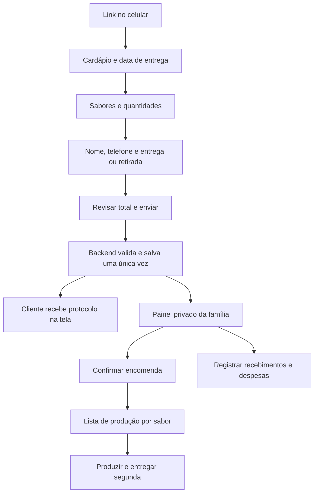

# Plano do app — Suquinhos Santos

Decisões atualizadas com a família em 11/11/2026. Este documento passa a orientar as próximas etapas; o roadmap anterior continua como histórico.

## Objetivo e regras confirmadas

Vender sucos por encomenda para pessoas próximas da família, pelo celular. O cliente recebe um link, acessa o cardápio e pode instalar o site como app na tela inicial (PWA). Android e iPhone devem ser atendidos. A instalação é opcional para comprar.

- Encomendas até sexta-feira às 18h, no fuso America/Sao_Paulo.
- Produção e entrega uma vez por semana, na segunda-feira; compras no sábado e organização no domingo.
- Sem estoque de suco pronto.
- Três sabores já existentes; R$ 12,00 por garrafa.
- Cliente sem conta na primeira versão; nome e telefone no pedido.
- Venda exclusiva a parentes e amigos próximos. A distribuição do link define o público desejado, mas sozinha não restringe o acesso; decidir se será necessário convite validado no servidor.
- Pagamento exclusivamente por Pix no momento da encomenda, com envio de comprovante pelo sistema. Na primeira versão proposta, a família confere o crédito e confirma o pagamento; integração Mercado Pago está em avaliação.
- Filho: front público, fotos, textos, usabilidade e testes no celular.
- Pai e filho: painel administrativo e backend; pai administra contas de infraestrutura e recuperação de acesso.

Ainda falta definir: volume da garrafa, entrega ou retirada, região atendida, taxa, chave Pix e titular recebedor, limite de produção, cancelamentos e contato comercial. Não exibir valores ou regras inventados. Ver [PAGAMENTOS_E_COMPROVANTES.md](PAGAMENTOS_E_COMPROVANTES.md) para o fluxo atualizado.

Proposta para validar antes do checkout real: às 18h de sexta a rodada fecha; o cliente vê a próxima data disponível antes de confirmar. Não transferir silenciosamente um pedido para outra semana. Exceções e feriados são configurados pela família por rodada, sem alterar pedidos antigos.

## Jornada do cliente e da família

O protocolo significa pedido recebido pelo sistema; a confirmação comercial fica separada. Só mostrar sucesso após a gravação no banco. Em falha de internet, manter o carrinho e permitir tentar novamente sem duplicar. Na primeira versão, a família consulta o painel para ver novos pedidos; notificações push ficam para uma etapa posterior.

## Arquitetura proposta

| Parte | Escolha | Responsabilidade |
| --- | --- | --- |
| Front público | HTML, CSS e JavaScript existentes | Cardápio, carrinho, formulário e instalação |
| Painel mobile | HTML, CSS e JS em páginas separadas | Login, pedidos, produção e caixa |
| API | Funções Node.js na hospedagem | Validar pedido, preços, prazo e autorização |
| Dados e acesso | Supabase Postgres e Auth | Persistência, login e políticas de acesso |
| Hospedagem candidata | Vercel em plano compatível com uso comercial | HTTPS, site e API |

Não é necessário reescrever o front em React ou Next.js para iniciar. O contrato da API permite desenvolver cada lado separadamente. A escolha de Vercel é proposta, não há projeto provisionado ou cobrança contratada.

Supabase faz sentido porque pedidos e finanças precisam existir fora do celular. LocalStorage continua servindo somente ao carrinho; nunca será a fonte do caixa ou dos pedidos recebidos.

## Painel privado

- Botão “Entrar” no site, abrindo uma tela de login verdadeira quando Auth estiver conectado. Sem cadastro público de administradores.
- Contas individuais de familiares convidados, com autorização explícita. Estar logado sozinho não concede acesso ao negócio.
- Início: pedidos da rodada, garrafas por sabor, valor encomendado, recebido, a receber, despesas e saldo do período.
- Pedidos: lista e detalhe, cliente, itens, rodada, entrega/retirada e histórico de alterações.
- Estados operacionais: recebido → confirmado → em produção → entregue; cancelado em fluxo separado.
- Pagamento é independente do estado operacional: aguardando Pix → comprovante enviado/em conferência → pago, ou divergência; reembolso em fluxo separado. Parcial será uma exceção a resolver, não uma modalidade oferecida ao cliente. Enviar comprovante não cria receita nem comprova crédito.
- Produção: quantidades dos pedidos confirmados, excluindo cancelados. Não converter garrafas em quilos de fruta sem ficha de rendimento aprovada.
- Caixa: recebimentos, despesas, reembolsos, aportes e retiradas separados. Corrigir por estorno, preservando histórico.
- Rodadas: data de entrega, fechamento, abertura/pausa e eventual capacidade aprovada.
- Exportação CSV e recuperação de dados verificadas antes da operação real.

## Regras financeiras

Guardar dinheiro em centavos inteiros. Guardar preço e descrição do produto no item do pedido: mudar o catálogo não muda o histórico.

Exemplo: 10 garrafas = R$ 120 encomendados. Se entraram R$ 60 e foram gastos R$ 35, há R$ 60 a receber e R$ 25 de movimento líquido de caixa. Isso não é automaticamente lucro: faltam apuração de custos e eventual saldo inicial.

- Saldo = saldo inicial + entradas efetivas − saídas efetivas.
- Pedido não pago não gera entrada.
- Marcar como entregue não marca como pago.
- Recebimento parcial reduz o valor a receber; impedir receber acima do saldo sem tratamento explícito.
- Cancelar pedido pago exige decidir e registrar reembolso; não apagar o pagamento.
- Aporte do pai e retirada da família afetam caixa, mas não são receita de venda nem custo de produção.
- Relatórios separam a rodada de entrega e a data real do movimento financeiro.

## Modelo de dados a implementar

| Tabela | Conteúdo |
| --- | --- |
| products | Sabores, preço atual, imagem e ativo |
| delivery_cycles | Entrega, fechamento com fuso, estado e capacidade opcional |
| orders | UUID, protocolo aleatório, rodada, nome/telefone, modalidade, dados necessários e status |
| order_items | Pedido, produto, quantidade e preço/descrição históricos |
| cash_entries | Tipo, centavos, data efetiva, categoria, pedido opcional, autor e estorno |
| family_members | Usuário Auth, negócio, papel e ativo; alteração restrita ao responsável |
| audit_events | Quem alterou pedido ou financeiro, quando e referência da operação |

Criar índices para rodada/status e movimentos por data. Pedido + itens devem ser uma transação; recebimento + atualização correlata também. Definir retenção e recuperação antes de guardar dados reais.

## Acesso e integridade

- Catálogo e datas públicas; pedidos, contatos e caixa privados.
- RLS em todas as tabelas expostas, com políticas por familiar autorizado. Testar visitante, usuário sem permissão e familiar.
- Checkout público passa por endpoint controlado, com limites de requisição persistentes, validação e mitigação de abuso. Não conceder leitura pública de pedidos nem inserção livre em tabelas financeiras.
- API calcula preço e total pelo catálogo, valida rodada/fechamento pelo relógio do servidor e grava com idempotência. Não confiar no preço enviado pelo celular.
- Identidade e autorização verificadas no servidor em toda operação administrativa. Segredos do Supabase somente no servidor, fora do Git e do front.
- Nenhum dado de cliente, resposta autenticada ou finanças em cache offline da PWA.
- Uma futura consulta de pedido pelo cliente exigirá autenticação ou token secreto próprio; protocolo público sozinho não autoriza ler telefone/endereço.

## Entregas pequenas, em ordem

| Etapa | Trabalho | Pronto quando |
| --- | --- | --- |
| 1 — Plano e base PWA | Manifesto, ícones, instruções Android/iPhone e contrato da API | Arquivos verificados; instalação real ainda precisa de HTTPS e celulares |
| 2 — Banco e login | Projeto Supabase, tabelas, políticas, convite, entrar/sair e recuperação | Familiar entra; visitante e usuário alheio não leem dados |
| 3 — Pedido completo | Catálogo/rodada reais, formulário, validação, transação e idempotência | Pedido fictício aparece no painel; repetir envio não duplica |
| 4 — Operação semanal | Confirmar/cancelar, totais por sabor e entrega | Pedido antes/depois do fechamento tratado corretamente; cancelado não entra na produção |
| 5 — Caixa | Entradas, despesas, parcial, estorno, filtros e exportação | Exemplo financeiro acima confere; cancelamento e reembolso não duplicam lançamentos |
| 6 — Piloto no celular | HTTPS, Android/iPhone, privacidade e recuperação/exportação | Pedido → painel → pagamento → entrega testado por vocês com dados fictícios |

Depois do ensaio, convidar poucas pessoas conhecidas. Notificações push, pagamento online, contas de clientes e relatórios avançados ficam para depois do piloto.

## Primeira entrega desta conversa

- [x] Regras e divisão de trabalho registradas.
- [x] Manifesto, ícones e instruções de instalação adicionados.
- [x] Contrato inicial de API documentado, sem endpoints fictícios ativos.
- [x] Sintaxe JavaScript, manifesto, referências e dimensões dos ícones verificados; Chrome reconheceu a opção de instalar. Layout conferido em larguras de 390 e 320 pixels, sem transbordamento horizontal na leitura de 320 pixels. Isso não substitui ensaio em celulares reais.
- [x] Projeto Supabase conectado; migrações e RLS verificados no banco real; primeiro acesso administrativo confirmado.
- Etapa 2 conectada pela CLI 3.1.0, preservando o plugin SynerTech. Login e painel de consulta funcionando; tabelas e bucket privado criados. Testes de RLS no banco real passaram e o primeiro login foi confirmado. Recuperação e publicação ainda precisam de revisão antes do piloto. Ver [CONFIGURAR_SUPABASE.md](CONFIGURAR_SUPABASE.md).
- [ ] Implementar checkout e painel reais.
- [ ] Publicar e testar instalação em Android e iPhone reais.

Não foi contratado plano nem comprado domínio. O banco em nuvem foi configurado e o painel local está conectado para consulta. Checkout, comprovantes e lançamentos ainda serão implementados.

## Domínio, hospedagem e instalação

Domínio próprio é opcional. A Vercel fornece endereço terminado em `.vercel.app`. Se decidirem comprar domínio, é melhor fazê-lo antes de distribuir amplamente: mudar a origem exige reinstalação e não transporta automaticamente o carrinho/sessão da instalação antiga.

O Hobby da Vercel é para uso pessoal não comercial; para vendas, avaliar plano comercial ou outra hospedagem compatível. Consultar preços e limites na contratação. Instalação depende de HTTPS e do suporte do navegador. No iPhone, orientar pelo menu Compartilhar do Safari; o botão de instalação programático não é suportado no iOS.

Esta base não inclui funcionamento offline nem notificações. Uma PWA pode ser instalável sem service worker. Catálogo e principalmente pedidos/caixa dependem de internet nesta versão.

Fontes consultadas em 11/11/2026:
- [Instalação PWA — MDN](https://developer.mozilla.org/en-US/docs/Web/Progressive_web_apps/Guides/Making_PWAs_installable)
- [Domínios Vercel](https://vercel.com/docs/domains/working-with-domains)
- [Plano Hobby e restrição comercial](https://vercel.com/docs/plans/hobby)
- [Chaves Supabase](https://supabase.com/docs/guides/getting-started/api-keys)

## Atualização — fluxo de encomendas implementado em 11/11/2026

O registro vigente desta etapa está em [ENTREGA_ENCOMENDAS.md](ENTREGA_ENCOMENDAS.md). Rodadas, reserva, Pix, anexo privado, confirmação e entrada única no caixa foram conectados e testados no navegador com dados fictícios, removidos ao final. Os detalhes antigos sobre ausência de upload ou painel apenas de consulta ficam substituídos por esse registro. Publicação, despesas/estornos e ensaio em celulares reais continuam pendentes.
